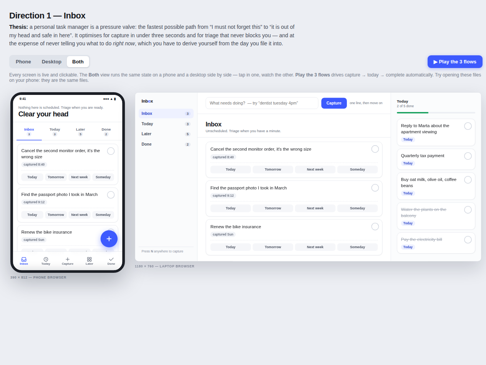
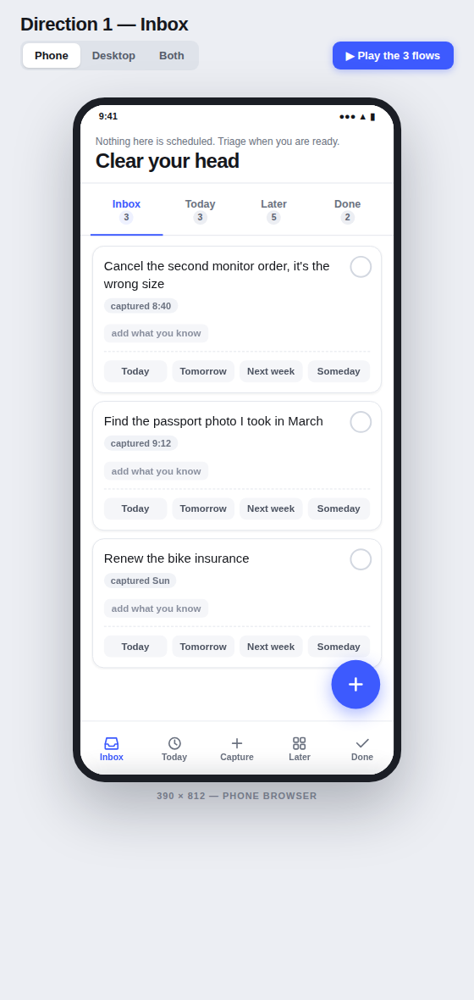
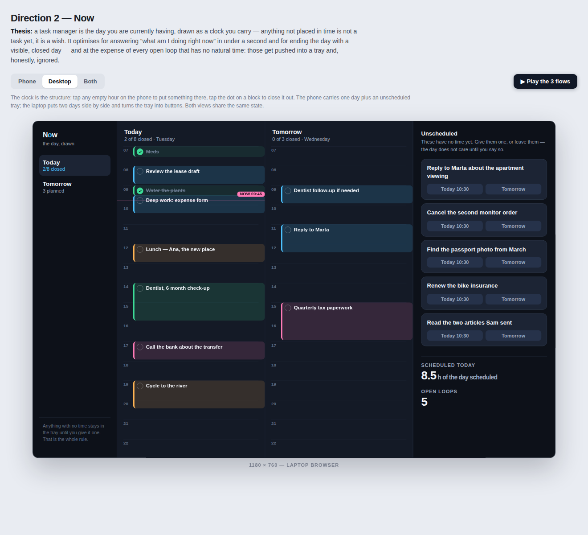
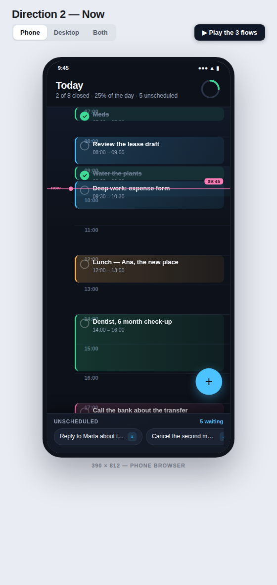
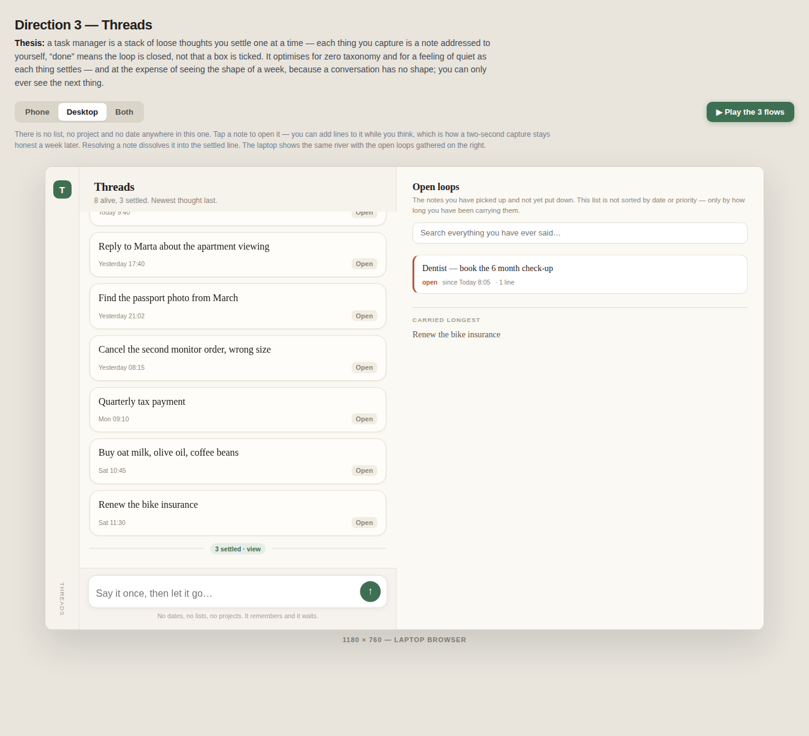
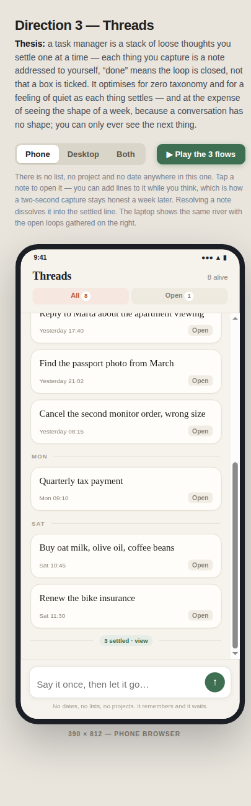
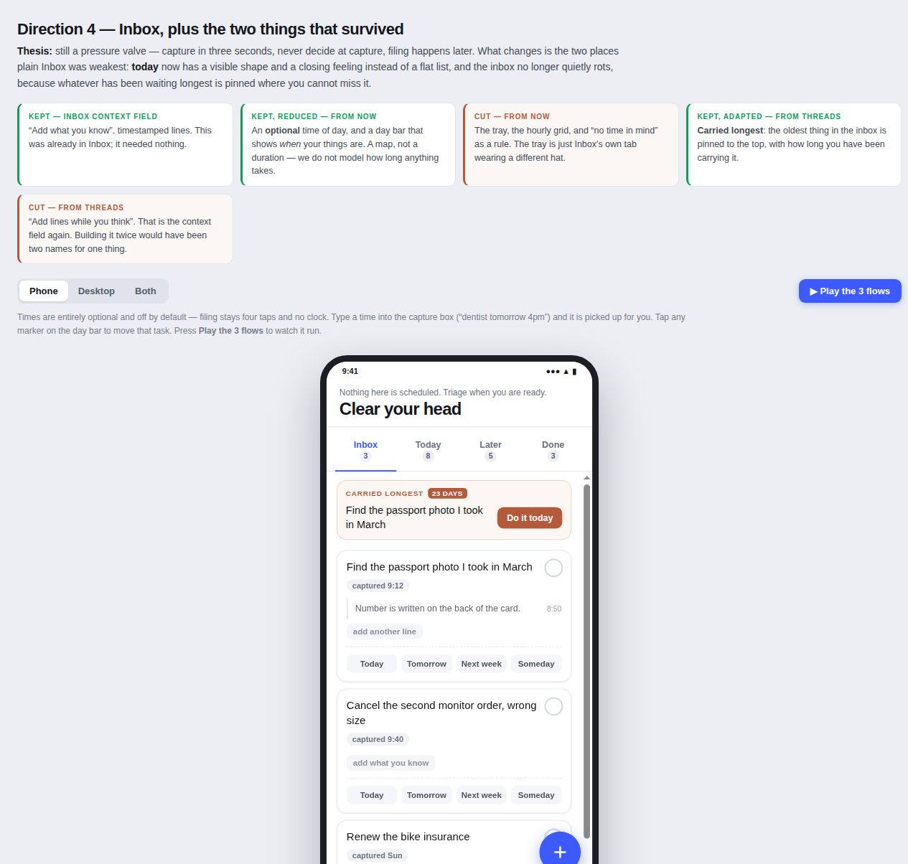
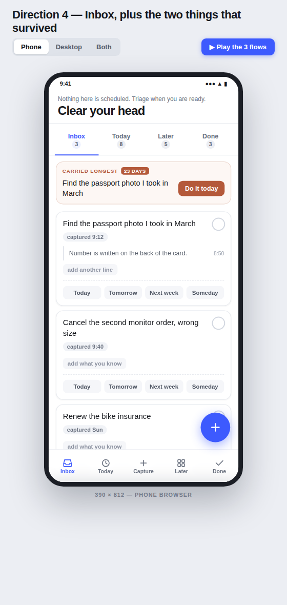

# Tasks

A personal task manager, built for one person, used every day.

> **Status: design exploration.** Nothing is implemented yet. This repo
> currently holds four candidate designs for you to choose between.

## The goal

The owner wants a simple, modern task app they will actually use daily, after
finding the incumbent tools "difficult to work with". They have not decided
what it should look like, so **four directions were built first and the pick
comes after**.

## The four directions

Each is a working prototype, not a mockup. Open the `index.html` in any browser,
switch between **Phone** and **Desktop**, and press **Play the 3 flows** to watch
capture → today → complete run automatically.

| | Structure | Optimises for | Deliberately gives up |
|---|---|---|---|
| [**Inbox**](design/inbox/) | capture-first triage | capture in under 3 seconds | never tells you what to do *now* |
| [**Now**](design/now/) | clock / day timeline | "what am I doing right now" in under a second | open loops get trayed and ignored |
| [**Threads**](design/threads/) | no lists, no dates, no taxonomy | quiet; zero organisation overhead | you never see the shape of a week |
| [**Synthesis**](design/fourth/) | Inbox, plus the two borrowed ideas that survived | capture speed *and* a sense of "now" | a little more surface than Inbox alone |

### 1. Inbox — capture as a pressure valve

> *A personal task manager is a pressure valve: the fastest possible path from
> "I must not forget this" to "it is out of my head and safe in here."*





### 2. Now — the day as a clock you carry

> *A task manager is the day you are currently having, drawn as a clock you
> carry — anything not placed in time is not a task yet, it is a wish.*





### 3. Threads — a stack of loose thoughts

> *A task manager is a stack of loose thoughts you settle one at a time — each
> thing you capture is a note addressed to yourself; "done" means the loop is
> closed, not that a box is ticked.*





### 4. Synthesis — Inbox, plus the two things that survived

> *Still a pressure valve — capture in three seconds, never decide at capture,
> filing happens later. What changes is the two places plain Inbox was weakest:
> **today** now has a visible shape and a closing feeling instead of a flat
> list, and the inbox no longer quietly rots, because whatever has been waiting
> longest is pinned where you cannot miss it.*

Built after reading what the owner liked across the first three. It grafts two
ideas onto Inbox — an **optional time of day** (never inferred from a bare time,
see below) and **carried longest** pinned to the top — and adds a **day bar**.





**This is the current recommendation.** If the owner cannot choose, the
advisor's stopping rule applies: fall back to the most structurally
conservative direction, say so out loud, and revisit after a week of real use.

## Design rules already settled

These were found by using the prototypes, not by reading them. Do not
re-litigate:

- **Capture makes no decisions.** A bare time is never a date. Typing
  "call mum at 9am" stays undated with the time retained — guessing "today"
  invents an overdue item nobody created, which is a guilt tax.
- **Nothing typed is ever discarded.**
- **Every graft must have a distinct job.** Two surfaces doing one job means
  one of them is always empty and reads as broken. This is why there is one
  landing page, at the repo root, and not a second copy under `design/`.

## What the app has to be

Decided before any code was written:

- **Hosted web app.** Reachable from any browser, on any device, over the
  internet. Not a local or desktop app.
- **One owner.** One list, many devices. Collaboration, sharing and second users
  are out — same data model, more ways to reach it.
- **The whole product is:** a text task, a due date, a priority, and done.
- **Explicitly out:** offline editing or a sync engine, attachments or images,
  push notifications, native apps, multi-user accounts.
- **Identity cannot be deferred** — retrofitting auth touches every route,
  query and session. The database engine *can* be deferred, as long as a thin
  data layer sits in front of it from day one.

## Where the build goes next

1. **Slice 0 — Foundation and reachability.** Migrations from commit one,
   deployed and reachable from a real phone, behind single-owner auth. No
   user-facing features yet.
2. **Slice 1 — Vertical slice.** Add a task, see it, complete it — on the real
   hosted stack. Owner-testable immediately: add on the laptop, see it on the
   phone.
3. **Slice 2 — The daily loop.** Today as the default view, complete and
   un-complete, delete with recovery, deliberate empty-state behaviour.
4. **Slice 3 — Friction and feel.** Keyboard shortcuts, fast capture, fast
   edit, dark mode, motion, typography. **The largest slice by hours.**
5. **Slice 4 — Time and shape.** Due dates, priorities, Upcoming. Only now do
   recurrence and search earn their place.

Slice 3 must not follow slice 4. Building the full data model before the feel
is how you end up with a correct app nobody wants to open.

## Trying the prototypes

They are self-contained — no build step, no dependencies, no assets:

```bash
git clone git@github.com:jashp3/rig-tasks.git
cd rig-tasks
xdg-open design/inbox/index.html      # or just double-click it
```

To re-render the screenshots in `design/screenshots/` after an edit:

```bash
./scripts/shot.sh design/inbox/index.html design/screenshots/inbox-desktop.png 1280 900
```

## Layout

```text
SPEC.md            project intent
project.yaml       OpenRig project manifest
design/
  inbox/           direction 1
  now/             direction 2
  threads/         direction 3
  fourth/          direction 4 - the synthesis
  index.html       redirect to the root landing page
  screenshots/     rendered previews (GitHub cannot render .html inline)
scripts/shot.sh    headless screenshot helper
missions/          slice tracking
```
